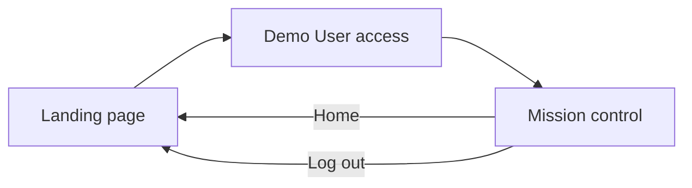
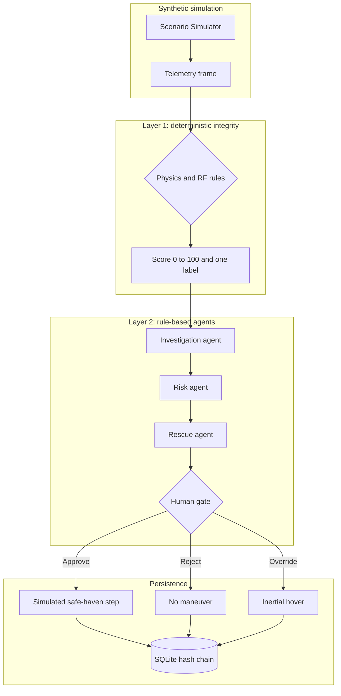
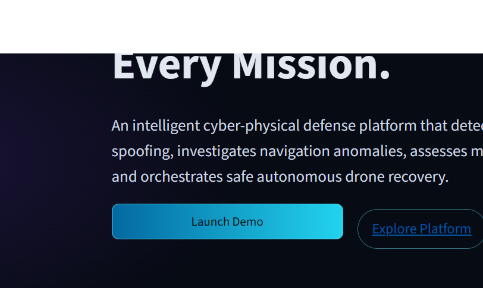
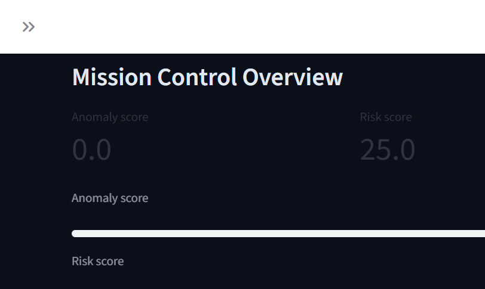
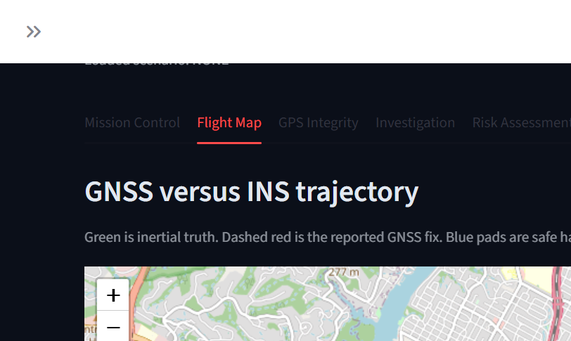
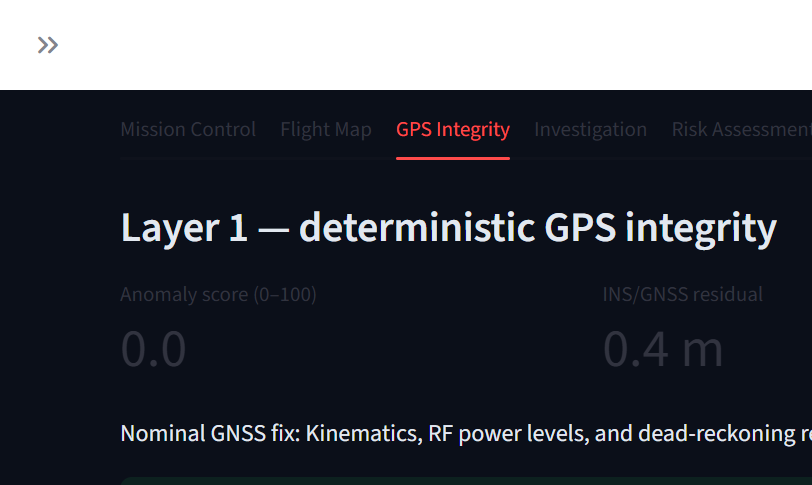

# FINDR AI — GPS Spoofing Detection & Delivery Rescue

FINDR AI is a local, explainable GPS monitor for traditional e-commerce deliveries by motorcycle, scooter, car, and van. It scores synthetic GNSS telemetry with deterministic physics rules, asks three rule-based agents to investigate, score risk, and recommend a parcel handoff, and refuses to treat that handoff as done until a human operator authorizes it.

The vehicles, satellites, and radios in this repository are mathematical simulations. FINDR does not transmit RF, talk to live GNSS hardware, track a real courier, or call a paid model API. Tagline: Intelligent GPS Security for Trusted Deliveries.

## Problem statement

A delivery vehicle that trusts GNSS can be steered off its corridor, or marked arrived, by a forged position. A single bad fix is not enough to call every deviation an attack: street-canyon multipath also moves the reported coordinate. The operator needs a record of what the vehicle reported, what the reference track believed, why an agent called it suspicious, and who authorized the handoff.

## Proposed solution

FINDR keeps those jobs in separate layers:

1. A scenario simulator builds synthetic telemetry for delivery runs.
2. Layer 1 applies kinematic, inertial-residual, C/N0, and constellation-replay rules and emits a 0–100 score plus one primary label.
3. Layer 2 agents explain that label, score mission risk, and pick a recovery. They do not relabel a benign multipath frame as spoofing.
4. A human must approve, reject, or override a consequential plan before it is treated as executed.
5. SQLite stores the frame, the agent record, and the operator decision in a SHA-256 hash chain that can be verified.

## Application navigation

The first screen is the landing page. Launch Demo, Launch Dashboard, and Launch FINDR Mission Control all open the same guest access card. Continue as Demo User opens the existing mission-control dashboard. No email, password, OTP, or external account is used.

The card shows Demo User, Mission Control Operator, Full Demo Dashboard, and Guest Demo Access. The sidebar says this is a guest demo session, not a production login.

Home returns to the landing page and leaves the loaded timeline and the SQLite log in place. Log out clears the guest flag and returns to the landing page. It does not delete audit rows. A full browser refresh starts again on the landing page, because the guest flag lives in Streamlit session state.



## Architecture



## Technology stack

- Python 3.10+
- Streamlit and streamlit-folium
- Pydantic 2
- NumPy and Pandas
- Folium and Leaflet with OpenStreetMap tiles
- SQLite through the Python standard library for the GPS audit log
- PyMongo for MongoDB Atlas
- FastAPI for the document API
- SQLite through the Python standard library for the GPS audit hash chain
- Pytest

There is no LLM client and no API key. Nearby places come from the public Overpass API. A failed search does not invent landmarks.

## Features

**Synthetic telemetry.** `ScenarioSimulator` drives a short Austin street corridor and can replay the same noise with `seed`. Pass `seed=409` to match the dashboard. Each of the seven delivery scenarios uses its own pickup and customer coordinate pair.

**Layer 1 integrity.** `DeterministicIntegrityEngine` checks, in order:

- single-step displacement above 150 m, labeled a teleport
- implied speed above 30 m/s without that leap, which does not by itself become an attack
- acceleration above 12 m/s²
- GNSS versus INS residual, warning at 18 m and critical at 45 m
- a residual of 400 m or more, which keeps a persisted teleport labeled as a teleport rather than slow drift
- mean satellite C/N0 above 51.5 dB and near-zero C/N0 variance
- four epochs of identical HDOP, identical C/N0 vectors, and zero clock drift
- elevated HDOP with a still-bounded residual, labeled multipath and capped at a score of 25 so it is not an attack

**Investigation agent.** Explains the Layer 1 label with RF text, the INS gap, and a synthetic cellular fix placed a few meters from the inertial position. That cellular fix is not a live 5G measurement.

**Risk agent.** Adds parcel class, navigation fault, and vehicle battery. Organ transport on a clean delivery stays LOW. The same parcel on multipath stays MEDIUM and does not demand a spoofing handoff. A rules-matched spoof on that parcel is HIGH or CRITICAL.

**Rescue agent.** Picks the nearest secured pad that still has landing capacity, measured from the inertial position, not from the reported GNSS fix. A full pad is skipped. Multipath recommends a hover that still waits for an operator. Spoofing recommends a safe-haven divert that waits for an operator. Battery below 18 percent recommends an immediate descent that also waits.

**Human gate.** Approve authorizes the recommended handoff. Reject cancels it and does not move the vehicle. Override switches the plan to a hold and does not take the handoff. A second decision on the same incident is rejected. A blank operator name is rejected. The decision is written to SQLite before the in-memory plan changes, and the dashboard reads it back after a Streamlit rerun.

**Audit log.** Each incident and each operator decision is an event whose SHA-256 covers the canonical JSON payload and the previous event hash. `verify_integrity()` recomputes the chain, checks that incident scores still match the hashed payload, and checks an anchor row that records the chain length and tip. Editing a stored score fails verification. Deleting the newest event without updating the anchor fails verification. Rewriting the chain and the anchor together is not detected. The log is tamper-evident, not tamper-proof.

## Six simulated scenarios

Seed 409, 18 frames, attack start at frame 8. Scores below are the values produced by that run.

| Scenario | What the simulator does | Onset frame | Last frame | Risk | Plan |
| --- | --- | --- | --- | --- | --- |
| Clean nominal delivery | Corridor noise only | NONE, score 0, not an attack | NONE, score 0 | LOW | Continue delivery, no approval |
| Teleportation jump | About a 900 m leap and 88 m/s | TELEPORTATION_JUMP, score 100, attack | TELEPORTATION_JUMP, score 65, attack | CRITICAL | Safe-haven divert, pending |
| Insidious creeping drift | A few meters of lateral offset each second | NONE, score 0 | INSIDIOUS_DRIFT, score 50, attack | CRITICAL | Safe-haven divert, pending |
| High-power RF surge | C/N0 near 56 dB with almost no variance | RF_POWER_SURGE, score 80, attack | RF_POWER_SURGE, score 80, attack | CRITICAL | Safe-haven divert, pending |
| Constellation replay freeze | Identical C/N0, DOP, and zero clock drift | NONE until four identical epochs exist | CONSTELLATION_FREEZE, score 40, attack | CRITICAL | Safe-haven divert, pending |
| Urban canyon multipath | HDOP 3.8, fewer satellites, a few meters of bounce | MULTIPATH_INTERFERENCE, score 15, not an attack | same | MEDIUM | Hover, pending approval |

Creeping drift and constellation replay are silent on the first bad frame. Drift has to accumulate past the inertial threshold. Replay has to repeat for four epochs. That delay is intentional.

## Installation

Python 3.10 or newer. From the repository root:

```bash
python -m venv .venv
```

Windows PowerShell:

```powershell
.\.venv\Scripts\Activate.ps1
python -m pip install -r requirements.txt
```

macOS and Linux:

```bash
source .venv/bin/activate
python -m pip install -r requirements.txt
```

`pyproject.toml` lists the same dependency pins and sets Pytest's `pythonpath` to the repository root.

If `pytest` or `streamlit` is not on PATH, call them as `python -m pytest` and `python -m streamlit`. If port 8501 is taken, add `--server.port 8502`. Run both commands from the repository root so `import src` resolves. `findr_audit.db` is created beside the app and is gitignored; delete it to reset the log.

## Execution

```bash
python -m streamlit run app.py
```

Open `http://localhost:8501`. The landing page loads first. Choose Launch Demo, then Continue as Demo User. In the dashboard, choose a scenario and **Run Synthetic Scenario**. The timeline slider selects one frame. Mission Control, the map, integrity, investigation, risk, and rescue all read that frame. Approve, reject, or override on the Rescue tab. Verify the hash chain on the Audit tab. Log out returns to the landing page.

## Smart meeting point

Use this when the loaded synthetic order cannot be handed over at the door. It does not replace the GPS integrity tabs, and a coordinate near the destination does not mark the order delivered.

1. Run a scenario so an order and a telemetry frame are loaded.
2. On Dashboard, choose **Can't find customer location?**, then open the **Meeting Point** tab. The panel is rendered once, on that tab, and it follows the selected order and frame.
3. Stay on **Delivery partner**. The default position is the synthetic frame and is labeled as demonstration data, not live GPS. **Use device GPS** asks the browser for a real fix and is the only source that shows a metre accuracy and an uncertainty circle.
4. Search nearby public places. The default radius is 500 metres around the customer destination. OpenStreetMap must be reachable. Shops, bus stops, and other public amenities are kept. Private and restricted places are dropped. If the request fails or returns nothing, the list stays empty and the partner can enter a manual point. That manual point is labeled as not an OpenStreetMap suggestion.
5. Request the meeting point. Switch the demo role to **Customer**. Confirm or reject a suggestion. Confirmation creates a 6-digit order OTP. The code is shown once to the customer and is stored only as a SHA-256 of `order_id:code`.
6. Switch back to **Delivery partner**. Copy the confirmed coordinates or open OpenStreetMap directions. Enter the OTP. A high-risk frame, or a reported position more than 150 metres from the reference track, stays blocked until **Operator authorizes this high-risk handover** is checked.
7. A successful handover writes the meeting point, the time, and the delivery-agent ID. The customer can consent to an approximate partner location and an estimated arrival. Exact partner coordinates stay on the partner record.

## MongoDB Atlas

Create a free cluster, a database user, and a network-access entry for your IP. Atlas will not connect if the IP is missing from that list. Copy the SRV connection string into `.env` using `.env.example`. The password stays in the environment. Do not commit `.env`.

`MONGODB_URI` is the connection string. `MONGODB_DB` defaults to `findr_ai`. `DEMO_API_TOKEN` is the bearer token for the API. The Streamlit guest card does not use that token. Continue as Demo User still opens the dashboard as Delivery Operations Operator.

On a successful ping the app creates `users`, `delivery_agents`, `delivery_orders`, `telemetry_frames`, `anomaly_events`, `rescue_actions`, and `audit_logs`, plus the meeting-point collections. GPS fields are GeoJSON points with `[longitude, latitude]` and 2dsphere indexes. Agent IDs, order IDs, and timestamps are indexed. The demo user document is inserted if it is missing. If `MONGODB_URI` is unset or Atlas does not answer, meeting points stay in process memory and the dashboard keeps writing SQLite. That memory store is not a live database. `python -m pytest` uses the memory store and does not need Atlas.

Initialize from the existing audit file. This copies rows and leaves `findr_audit.db` unchanged:

```bash
python -m src.persistence.migrate
```

The copy is idempotent. Chain hashes are stored as they were written. `AuditDatabase.verify_integrity()` still checks SQLite.

Run the dashboard and the API from the repository root. Bind them to localhost. Cloudflare Tunnel is the public HTTPS path. Do not publish ports 8501 or 8000 on the host firewall.

```bash
python -m streamlit run app.py --server.address 127.0.0.1 --server.port 8501
python -m uvicorn src.api.main:app --host 127.0.0.1 --port 8000 --proxy-headers --forwarded-allow-ips 127.0.0.1
```

## Cloudflare

Cloudflare Workers and Cloudflare Pages do not run this Streamlit process or this FastAPI process. The Python services stay on a machine with a durable disk for `FINDR_AUDIT_DB`. `cloudflared` makes an outbound connection to Cloudflare, and Cloudflare serves HTTPS for hostnames on a domain you add there. No public URL exists until that tunnel is authorized and those hostnames are published.

Set `FINDR_AUDIT_DB` to a path that survives restarts. MongoDB Atlas stays the document database. R2 can hold a backup copy of the SQLite file. It is not the live hash-chain file. `FINDR_CORS_ORIGINS` lists the public dashboard origin if a browser on another host calls the API. The Streamlit dashboard does not call the API over HTTP.

`deploy/cloudflared/config.example.yml` shows the two local routes. A tunnel created in the Cloudflare dashboard takes its routes from that dashboard, not from the file. Do not commit a tunnel token or credentials JSON.

`GET /health` needs no token. Other routes expect `Authorization: Bearer` plus `DEMO_API_TOKEN`. `POST /auth/demo` returns the operator profile. `POST /telemetry` runs the existing integrity engine. List routes accept `limit` (max 100) and `offset`. A missing token is 401. A missing `DEMO_API_TOKEN` or a down cluster is 503. Invalid JSON is 422.

## Tests

```bash
python -m pytest -v
```

The suite covers all six scenarios, residuals and kinematic bounds, RF surge, replay, multipath versus spoofing, risk bands, safe-haven selection, approve / reject / override, duplicate decisions, SQLite history, and hash-chain verification. Classification regression checks both the 18-frame and 22-frame teleport windows, keeps creeping drift distinct from a teleport, and checks that a later run does not rewrite older stored labels. Navigation tests cover the landing page, the guest access card, session persistence, logout, and the rule that mission control stays behind the access card. Dashboard frame selection and audit filtering are tested without starting Streamlit.

Latest run on Python 3.14.7: **105 passed in 15.70s**. The meeting-point tests cover public-place filtering, a failed Overpass response that adds no landmarks, OTP confirmation, the rule that proximity does not deliver an order, a high-risk block until an operator authorizes it, and the Meeting Point tab being rendered once. The MongoDB tests cover GeoJSON longitude-first copies, an unchanged SQLite hash chain after migration, pagination, and the demo bearer gate around a real integrity score.

## Dashboard

The landing page is the first screen. Launch Demo opens the guest card; Continue as Demo User opens mission control.



After a scenario run the app has seven tabs: Dashboard, Live Map, GPS Integrity, Investigation, Risk Assessment, Parcel Recovery, and Audit Logs. These captures are from a clean delivery (seed 409, frame 21): anomaly 0, risk 25, and an OpenStreetMap track of the reference and reported paths. The selector also runs GPS spoofing, gradual drift, a teleport, a false arrival, a route deviation, and suspicious movement.







## Example output

The table in [Six simulated scenarios](#six-simulated-scenarios) is the console result for seed 409. A confirmed teleport or RF surge ends pending:

```text
TELEPORTATION_JUMP  score=65  anomalous=True  risk=CRITICAL  action=REROUTE_SAFE_HAVEN  approval=PENDING
MULTIPATH_INTERFERENCE  score=15  anomalous=False  risk=MEDIUM  action=HOVER_HOLD_VERIFY  approval=PENDING
NONE  score=0  anomalous=False  risk=LOW  action=MAINTAIN_COURSE  approval=NOT_REQUIRED
```

`AuditDatabase.verify_integrity()` returns `(True, [])` on an unmodified log. After `UPDATE incidents SET anomaly_score = 99`, it returns `False` and a `tampered anomaly score` message.

## Safety statement

All coordinates, C/N0 values, clock drift, and the cellular cross-check are synthetic. FINDR does not connect to a receiver, transmit on any band, or command a real vehicle. Recovery steps update an in-memory inertial state only after approval.

## Limitations

- The hash chain lives in the same SQLite file as the anchor. Someone who can rewrite both can produce a new chain that still verifies. The chain catches an edited row and a deleted tip that leaves the anchor behind.
- Deleting the newest events and updating the anchor is not independently anchored outside this file.
- Agents are deterministic rules. They are not a language model.
- The cellular fix is a fixed offset from the inertial position, so it agrees with INS by construction.
- Replay detection needs four identical epochs. A one-frame freeze is not enough.
- Creeping drift is not labeled until the inertial residual crosses the critical threshold.
- A modest step slightly above 30 m/s is reported as a speed-bound violation and is not, by itself, a teleport.
- This is not a certified navigation or aviation system. It is a hackathon simulation of the decision loop.
- Guest access is a session flag. It is not authentication. A browser refresh returns to the landing page.
- Older audit rows keep the label written when they were scored. They are not migrated when a detection rule changes. Rewriting them would break the hash chain.
- Meeting-point suggestions depend on the public Overpass API. A timeout or error leaves the suggestion list empty.
- The meeting-point line and the OpenStreetMap directions link are not a private turn-by-turn router. The delivery simulator still draws a straight corridor.
- Device GPS is whatever the browser returns after permission. The synthetic frame is never presented as that reading.
- The customer OTP is shown in this single-user demo. It is not sent to a phone.
